# Community 0

> 192 nodes · cohesion 0.03

## Key Concepts

- [load()](file:///Users/macbook/ProjectTracker/tracker/storage.py#L100) (162 connections)
- [save()](file:///Users/macbook/ProjectTracker/tracker/storage.py#L112) (120 connections)
- [admin.py](file:///Users/macbook/ProjectTracker/tracker/routes/admin.py#L1) (61 connections)
- [today()](file:///Users/macbook/ProjectTracker/tracker/storage.py#L143) (56 connections)
- [create_app()](file:///Users/macbook/ProjectTracker/tracker/__init__.py#L54) (26 connections)
- [projects.py](file:///Users/macbook/ProjectTracker/tracker/routes/projects.py#L1) (26 connections)
- [new_id()](file:///Users/macbook/ProjectTracker/tracker/storage.py#L139) (20 connections)
- [storage.py](file:///Users/macbook/ProjectTracker/tracker/storage.py#L1) (20 connections)
- [__init__.py](file:///Users/macbook/ProjectTracker/tracker/__init__.py#L1) (15 connections)
- [main()](file:///Users/macbook/ProjectTracker/tools/investigate_bug_map.py#L27) (13 connections)
- [add_bundle_version_route()](file:///Users/macbook/ProjectTracker/tracker/routes/admin.py#L516) (11 connections)
- [bundles()](file:///Users/macbook/ProjectTracker/tracker/routes/admin.py#L431) (10 connections)
- [update_bundle_version()](file:///Users/macbook/ProjectTracker/tracker/routes/admin.py#L494) (9 connections)
- [QuoteClientOverrideRoutesTest](file:///Users/macbook/Documents/ProjectTracker/tests/test_quote_client_override.py#L95) (9 connections)
- [catalogo()](file:///Users/macbook/ProjectTracker/tracker/routes/admin.py#L165) (8 connections)
- [ProyectoEjecutivoQuoteRoutesTest](file:///Users/macbook/Documents/ProjectTracker/tests/test_proyecto_ejecutivo_quote.py#L26) (8 connections)
- [QuoteDescTextareaRouteTest](file:///Users/macbook/Documents/ProjectTracker/tests/test_quote_desc_textarea.py#L64) (8 connections)
- [fichas()](file:///Users/macbook/ProjectTracker/tracker/routes/admin.py#L631) (7 connections)
- [proveedores()](file:///Users/macbook/ProjectTracker/tracker/routes/admin.py#L573) (7 connections)
- [team()](file:///Users/macbook/ProjectTracker/tracker/routes/admin.py#L702) (7 connections)
- [update_bundle()](file:///Users/macbook/ProjectTracker/tracker/routes/admin.py#L461) (7 connections)
- [kanban()](file:///Users/macbook/ProjectTracker/tracker/routes/projects.py#L72) (7 connections)
- [new_project()](file:///Users/macbook/ProjectTracker/tracker/routes/projects.py#L118) (7 connections)
- [purge_deleted_item()](file:///Users/macbook/ProjectTracker/tracker/routes/quotes.py#L808) (7 connections)
- [transaction()](file:///Users/macbook/ProjectTracker/tracker/storage.py#L22) (7 connections)
- *... and 167 more nodes in this community*

## Class Diagram

```mermaid
classDiagram
    class InvalidNumericData {
        +storage.py()
    }
    class DeletionsTest {
        +test_deletions.py()
        +.test_delete_project_cascades_and_unlinks_fichas()
        +.test_delete_catalog_items_marks_quote_and_ldm_refs_as_deleted_snapshots()
        +.test_hydrate_items_flags_deleted_catalog_snapshot_without_relinking()
        +.test_purge_deleted_catalog_items_removes_only_marked_rows()
    }
    class StoragePriorityTests {
        +test_priority_bugs.py()
        +.setUp()
        +.test_transaction_preserves_two_concurrent_request_updates()
        +.test_transaction_serializes_separate_server_processes()
        +.test_nonfinite_save_keeps_original_and_leaves_no_temp_file()
        +.test_transaction_exception_discards_all_changes()
    }
    class ProyectoEjecutivoQuoteRoutesTest {
        +test_proyecto_ejecutivo_quote.py()
        +.setUp()
        +.tearDown()
        +._quote_form()
        +.test_new_quote_form_offers_proyecto_ejecutivo_option()
        +.test_creates_quote_with_j_sequence_and_qty_one()
        +.test_view_page_hides_unidad_and_cantidad_columns()
        +.test_second_quote_increments_j_sequence()
    }
    class QuoteClientOverrideRoutesTest {
        +test_quote_client_override.py()
        +.setUp()
        +.tearDown()
        +._base_quote_form()
        +.test_new_quote_with_client_unchanged_has_no_override()
        +.test_new_quote_with_edited_client_saves_override()
        +.test_override_survives_later_project_client_change()
        +.test_edit_quote_updates_proposal_for()
        +.test_new_quote_form_prefills_client_with_project_client()
    }
    class QuoteDescTextareaRouteTest {
        +test_quote_desc_textarea.py()
        +.setUp()
        +.tearDown()
        +.test_edit_form_renders_textarea_with_content()
        +.test_new_quote_form_renders_empty_textarea()
        +.test_description_with_special_chars_is_escaped_as_text_content()
        +.test_multiline_description_round_trips_through_save()
        +.test_quote_view_page_preserves_line_breaks_visually()
    }
    class QuotePaymentsLinkRouteTest {
        +test_quote_payments_link.py()
        +.setUp()
        +.tearDown()
        +.test_project_detail_page_renders_payments_button_for_quote_row()
        +.test_view_quote_page_has_payments_anchor()
        +.test_payments_button_visible_even_for_closed_project()
    }
```

## Relationships

- No strong cross-community connections detected

## Source Files

- [/Users/macbook/Documents/ProjectTracker/tests/test_avance_routes.py](file:///Users/macbook/Documents/ProjectTracker/tests/test_avance_routes.py)
- [/Users/macbook/Documents/ProjectTracker/tests/test_deletions.py](file:///Users/macbook/Documents/ProjectTracker/tests/test_deletions.py)
- [/Users/macbook/Documents/ProjectTracker/tests/test_kanban.py](file:///Users/macbook/Documents/ProjectTracker/tests/test_kanban.py)
- [/Users/macbook/Documents/ProjectTracker/tests/test_payments.py](file:///Users/macbook/Documents/ProjectTracker/tests/test_payments.py)
- [/Users/macbook/Documents/ProjectTracker/tests/test_payments_summary.py](file:///Users/macbook/Documents/ProjectTracker/tests/test_payments_summary.py)
- [/Users/macbook/Documents/ProjectTracker/tests/test_project_financial_card_payments.py](file:///Users/macbook/Documents/ProjectTracker/tests/test_project_financial_card_payments.py)
- [/Users/macbook/Documents/ProjectTracker/tests/test_proyecto_ejecutivo_quote.py](file:///Users/macbook/Documents/ProjectTracker/tests/test_proyecto_ejecutivo_quote.py)
- [/Users/macbook/Documents/ProjectTracker/tests/test_quote_client_override.py](file:///Users/macbook/Documents/ProjectTracker/tests/test_quote_client_override.py)
- [/Users/macbook/Documents/ProjectTracker/tests/test_quote_client_sync.py](file:///Users/macbook/Documents/ProjectTracker/tests/test_quote_client_sync.py)
- [/Users/macbook/Documents/ProjectTracker/tests/test_quote_desc_textarea.py](file:///Users/macbook/Documents/ProjectTracker/tests/test_quote_desc_textarea.py)
- [/Users/macbook/Documents/ProjectTracker/tests/test_quote_payments_link.py](file:///Users/macbook/Documents/ProjectTracker/tests/test_quote_payments_link.py)
- [/Users/macbook/Documents/ProjectTracker/tests/test_quote_status_labels.py](file:///Users/macbook/Documents/ProjectTracker/tests/test_quote_status_labels.py)
- [/Users/macbook/Documents/ProjectTracker/tests/test_quote_status_select.py](file:///Users/macbook/Documents/ProjectTracker/tests/test_quote_status_select.py)
- [/Users/macbook/Documents/ProjectTracker/tracker/catalog_search.py](file:///Users/macbook/Documents/ProjectTracker/tracker/catalog_search.py)
- [/Users/macbook/Documents/ProjectTracker/tracker/deletions.py](file:///Users/macbook/Documents/ProjectTracker/tracker/deletions.py)
- [/Users/macbook/Documents/ProjectTracker/tracker/domain.py](file:///Users/macbook/Documents/ProjectTracker/tracker/domain.py)
- [/Users/macbook/ProjectTracker/tests/test_priority_bugs.py](file:///Users/macbook/ProjectTracker/tests/test_priority_bugs.py)
- [/Users/macbook/ProjectTracker/tools/investigate_bug_map.py](file:///Users/macbook/ProjectTracker/tools/investigate_bug_map.py)
- [/Users/macbook/ProjectTracker/tracker/__init__.py](file:///Users/macbook/ProjectTracker/tracker/__init__.py)
- [/Users/macbook/ProjectTracker/tracker/catalog.py](file:///Users/macbook/ProjectTracker/tracker/catalog.py)

## Audit Trail

- EXTRACTED: 481 (40%)
- INFERRED: 709 (60%)
- AMBIGUOUS: 0 (0%)

---

*Part of the graphify knowledge wiki. See [[index]] to navigate.*