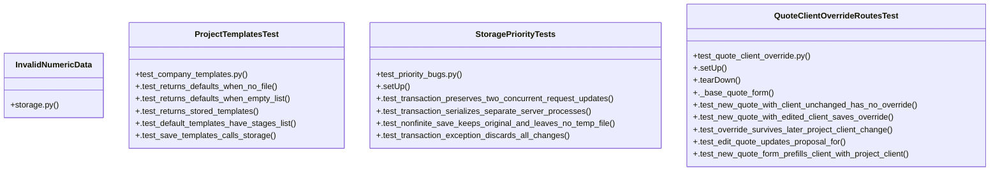

# Community 0

> 221 nodes · cohesion 0.02

## Key Concepts

- [load()](file:///Users/macbook/ProjectTracker/tracker/storage.py#L100) (167 connections)
- [save()](file:///Users/macbook/ProjectTracker/tracker/storage.py#L112) (125 connections)
- [admin.py](file:///Users/macbook/ProjectTracker/tracker/routes/admin.py#L1) (64 connections)
- [today()](file:///Users/macbook/ProjectTracker/tracker/storage.py#L143) (56 connections)
- [materials.py](file:///Users/macbook/ProjectTracker/tracker/routes/materials.py#L1) (45 connections)
- [projects.py](file:///Users/macbook/ProjectTracker/tracker/routes/projects.py#L1) (28 connections)
- [create_app()](file:///Users/macbook/ProjectTracker/tracker/__init__.py#L54) (26 connections)
- [storage.py](file:///Users/macbook/ProjectTracker/tracker/storage.py#L1) (21 connections)
- [new_id()](file:///Users/macbook/ProjectTracker/tracker/storage.py#L139) (20 connections)
- [quotes_mobile.py](file:///Users/macbook/ProjectTracker/tracker/routes/quotes_mobile.py#L1) (17 connections)
- [__init__.py](file:///Users/macbook/ProjectTracker/tracker/__init__.py#L1) (16 connections)
- [import_ldm_csv_upload()](file:///Users/macbook/ProjectTracker/tracker/routes/materials.py#L273) (15 connections)
- [main()](file:///Users/macbook/ProjectTracker/tools/investigate_bug_map.py#L27) (13 connections)
- [finite_float()](file:///Users/macbook/ProjectTracker/tracker/utils.py#L21) (13 connections)
- [_find_project()](file:///Users/macbook/ProjectTracker/tracker/routes/materials.py#L37) (12 connections)
- [mobile_generate_pdf()](file:///Users/macbook/ProjectTracker/tracker/routes/quotes_mobile.py#L176) (12 connections)
- [access.py](file:///Users/macbook/ProjectTracker/tracker/access.py#L1) (12 connections)
- [add_bundle_version_route()](file:///Users/macbook/ProjectTracker/tracker/routes/admin.py#L539) (11 connections)
- [import_ldm_pdf_create()](file:///Users/macbook/ProjectTracker/tracker/routes/materials.py#L786) (11 connections)
- [bundles()](file:///Users/macbook/ProjectTracker/tracker/routes/admin.py#L454) (10 connections)
- [new_ldm()](file:///Users/macbook/ProjectTracker/tracker/routes/materials.py#L225) (10 connections)
- [catalogo()](file:///Users/macbook/ProjectTracker/tracker/routes/admin.py#L185) (9 connections)
- [update_bundle_version()](file:///Users/macbook/ProjectTracker/tracker/routes/admin.py#L517) (9 connections)
- [edit_ldm()](file:///Users/macbook/ProjectTracker/tracker/routes/materials.py#L386) (9 connections)
- [import_ldm_pdf_map()](file:///Users/macbook/ProjectTracker/tracker/routes/materials.py#L758) (9 connections)
- *... and 196 more nodes in this community*

## Class Diagram

## Relationships

- [[Community 11]] (3 shared connections)
- [[Community 1]] (2 shared connections)

## Source Files

- [/Users/macbook/Documents/ProjectTracker/tests/test_avance_routes.py](file:///Users/macbook/Documents/ProjectTracker/tests/test_avance_routes.py)
- [/Users/macbook/Documents/ProjectTracker/tests/test_company_templates.py](file:///Users/macbook/Documents/ProjectTracker/tests/test_company_templates.py)
- [/Users/macbook/Documents/ProjectTracker/tests/test_kanban.py](file:///Users/macbook/Documents/ProjectTracker/tests/test_kanban.py)
- [/Users/macbook/Documents/ProjectTracker/tests/test_payments.py](file:///Users/macbook/Documents/ProjectTracker/tests/test_payments.py)
- [/Users/macbook/Documents/ProjectTracker/tests/test_payments_summary.py](file:///Users/macbook/Documents/ProjectTracker/tests/test_payments_summary.py)
- [/Users/macbook/Documents/ProjectTracker/tests/test_project_financial_card_payments.py](file:///Users/macbook/Documents/ProjectTracker/tests/test_project_financial_card_payments.py)
- [/Users/macbook/Documents/ProjectTracker/tests/test_proyecto_ejecutivo_quote.py](file:///Users/macbook/Documents/ProjectTracker/tests/test_proyecto_ejecutivo_quote.py)
- [/Users/macbook/Documents/ProjectTracker/tests/test_quote_client_override.py](file:///Users/macbook/Documents/ProjectTracker/tests/test_quote_client_override.py)
- [/Users/macbook/Documents/ProjectTracker/tests/test_quote_client_sync.py](file:///Users/macbook/Documents/ProjectTracker/tests/test_quote_client_sync.py)
- [/Users/macbook/Documents/ProjectTracker/tests/test_quote_desc_textarea.py](file:///Users/macbook/Documents/ProjectTracker/tests/test_quote_desc_textarea.py)
- [/Users/macbook/Documents/ProjectTracker/tests/test_quote_payments_link.py](file:///Users/macbook/Documents/ProjectTracker/tests/test_quote_payments_link.py)
- [/Users/macbook/Documents/ProjectTracker/tests/test_quote_status_labels.py](file:///Users/macbook/Documents/ProjectTracker/tests/test_quote_status_labels.py)
- [/Users/macbook/Documents/ProjectTracker/tests/test_quote_status_select.py](file:///Users/macbook/Documents/ProjectTracker/tests/test_quote_status_select.py)
- [/Users/macbook/Documents/ProjectTracker/tracker/catalog_search.py](file:///Users/macbook/Documents/ProjectTracker/tracker/catalog_search.py)
- [/Users/macbook/Documents/ProjectTracker/tracker/domain.py](file:///Users/macbook/Documents/ProjectTracker/tracker/domain.py)
- [/Users/macbook/Documents/ProjectTracker/tracker/services.py](file:///Users/macbook/Documents/ProjectTracker/tracker/services.py)
- [/Users/macbook/Documents/ProjectTracker/tracker/templates_config.py](file:///Users/macbook/Documents/ProjectTracker/tracker/templates_config.py)
- [/Users/macbook/ProjectTracker/tests/test_priority_bugs.py](file:///Users/macbook/ProjectTracker/tests/test_priority_bugs.py)
- [/Users/macbook/ProjectTracker/tools/investigate_bug_map.py](file:///Users/macbook/ProjectTracker/tools/investigate_bug_map.py)
- [/Users/macbook/ProjectTracker/tracker/__init__.py](file:///Users/macbook/ProjectTracker/tracker/__init__.py)

## Audit Trail

- EXTRACTED: 663 (44%)
- INFERRED: 829 (56%)
- AMBIGUOUS: 0 (0%)

---

*Part of the graphify knowledge wiki. See [[index]] to navigate.*