# Community 1

> 92 nodes · cohesion 0.04

## Key Concepts

- [auth.py](file:///Users/macbook/ProjectTracker/tracker/auth.py#L1) (29 connections)
- [IsolatedPriorityTests](file:///Users/macbook/ProjectTracker/tests/test_priority_bugs.py#L36) (15 connections)
- [auth_routes.py](file:///Users/macbook/Documents/ProjectTracker/tracker/routes/auth_routes.py#L1) (13 connections)
- [AuthTestCase](file:///Users/macbook/ProjectTracker/tests/test_auth.py#L7) (12 connections)
- [init_db()](file:///Users/macbook/ProjectTracker/tracker/auth.py#L25) (11 connections)
- [.grant()](file:///Users/macbook/ProjectTracker/tests/test_priority_bugs.py#L74) (10 connections)
- [access.py](file:///Users/macbook/ProjectTracker/tracker/access.py#L1) (10 connections)
- [_db_execute()](file:///Users/macbook/ProjectTracker/tracker/auth.py#L154) (9 connections)
- [.snapshot()](file:///Users/macbook/ProjectTracker/tests/test_priority_bugs.py#L77) (9 connections)
- [verify_credentials()](file:///Users/macbook/ProjectTracker/tracker/auth.py#L175) (8 connections)
- [DefaultAdminTests](file:///Users/macbook/Documents/ProjectTracker/tests/test_auth_defaults.py#L12) (8 connections)
- [create_user()](file:///Users/macbook/ProjectTracker/tracker/auth.py#L190) (7 connections)
- [get_user_by_username()](file:///Users/macbook/ProjectTracker/tracker/auth.py#L167) (7 connections)
- [set_user_permissions()](file:///Users/macbook/ProjectTracker/tracker/auth.py#L219) (6 connections)
- [._create_user()](file:///Users/macbook/ProjectTracker/tests/test_auth.py#L35) (6 connections)
- [.setUp()](file:///Users/macbook/ProjectTracker/tests/test_priority_bugs.py#L37) (6 connections)
- [can()](file:///Users/macbook/ProjectTracker/tracker/access.py#L8) (5 connections)
- [_default_admin_config()](file:///Users/macbook/ProjectTracker/tracker/auth.py#L56) (5 connections)
- [set_user_active()](file:///Users/macbook/ProjectTracker/tracker/auth.py#L197) (5 connections)
- [User](file:///Users/macbook/ProjectTracker/tracker/auth.py#L101) (5 connections)
- [.setUp()](file:///Users/macbook/ProjectTracker/tests/test_auth.py#L108) (5 connections)
- [.test_only_admin_can_delete_project_even_with_all_permissions()](file:///Users/macbook/ProjectTracker/tests/test_priority_bugs.py#L90) (5 connections)
- [check_document_access()](file:///Users/macbook/ProjectTracker/tracker/access.py#L82) (4 connections)
- [_db_query()](file:///Users/macbook/ProjectTracker/tracker/auth.py#L148) (4 connections)
- [reset_user_password()](file:///Users/macbook/ProjectTracker/tracker/auth.py#L201) (4 connections)
- *... and 67 more nodes in this community*

## Class Diagram

```mermaid
classDiagram
    class User {
        +auth.py()
        +.__init__()
    }
    class AuthTestCase {
        +test_auth.py()
        +.setUp()
        +.tearDown()
        +._create_user()
        +._login()
        +.test_login_page_returns_200()
        +.test_unauthenticated_redirect_to_login()
        +.test_login_success_redirects_to_dashboard()
        +.test_login_wrong_password_shows_error()
        +.test_login_unknown_user_same_error()
    }
    class DefaultAdminTests {
        +test_auth_defaults.py()
        +.setUp()
        +.tearDown()
        +._admin_row()
        +.test_configured_default_admin_credentials_are_used_on_first_init()
        +.test_configured_password_does_not_reset_existing_admin_by_default()
        +.test_configured_password_can_reset_existing_admin_when_enabled()
    }
    class BootstrapPriorityTests {
        +test_priority_bugs.py()
        +.test_no_configuration_generates_unique_password_and_preserves_existing_account()
    }
    class IsolatedPriorityTests {
        +test_priority_bugs.py()
        +.setUp()
        +.login()
        +.grant()
        +.snapshot()
        +.test_terms_script_and_both_editors_are_available()
        +.test_only_admin_can_delete_project_even_with_all_permissions()
        +.test_no_grants_denies_read_and_write_without_changing_data()
        +.test_each_permission_is_enforced_individually()
        +.test_import_cannot_bypass_quote_edit_permissions()
    }
```

## Relationships

- No strong cross-community connections detected

## Source Files

- [/Users/macbook/Documents/ProjectTracker/tests/test_auth_defaults.py](file:///Users/macbook/Documents/ProjectTracker/tests/test_auth_defaults.py)
- [/Users/macbook/Documents/ProjectTracker/tracker/extensions.py](file:///Users/macbook/Documents/ProjectTracker/tracker/extensions.py)
- [/Users/macbook/Documents/ProjectTracker/tracker/routes/auth_routes.py](file:///Users/macbook/Documents/ProjectTracker/tracker/routes/auth_routes.py)
- [/Users/macbook/ProjectTracker/tests/test_auth.py](file:///Users/macbook/ProjectTracker/tests/test_auth.py)
- [/Users/macbook/ProjectTracker/tests/test_priority_bugs.py](file:///Users/macbook/ProjectTracker/tests/test_priority_bugs.py)
- [/Users/macbook/ProjectTracker/tracker/access.py](file:///Users/macbook/ProjectTracker/tracker/access.py)
- [/Users/macbook/ProjectTracker/tracker/auth.py](file:///Users/macbook/ProjectTracker/tracker/auth.py)
- [/Users/macbook/ProjectTracker/tracker/routes/admin.py](file:///Users/macbook/ProjectTracker/tracker/routes/admin.py)
- [/Users/macbook/ProjectTracker/tracker/routes/materials.py](file:///Users/macbook/ProjectTracker/tracker/routes/materials.py)
- [/Users/macbook/ProjectTracker/tracker/routes/quotes.py](file:///Users/macbook/ProjectTracker/tracker/routes/quotes.py)

## Audit Trail

- EXTRACTED: 272 (76%)
- INFERRED: 88 (24%)
- AMBIGUOUS: 0 (0%)

---

*Part of the graphify knowledge wiki. See [[index]] to navigate.*