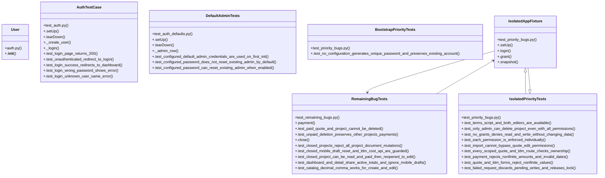

# Community 1

> 101 nodes · cohesion 0.04

## Key Concepts

- [auth.py](file:///Users/macbook/ProjectTracker/tracker/auth.py#L1) (30 connections)
- [.grant()](file:///Users/macbook/ProjectTracker/tests/test_priority_bugs.py#L74) (18 connections)
- [RemainingBugTests](file:///Users/macbook/ProjectTracker/tests/test_remaining_bugs.py#L16) (17 connections)
- [auth_routes.py](file:///Users/macbook/ProjectTracker/tracker/routes/auth_routes.py#L1) (16 connections)
- [.snapshot()](file:///Users/macbook/ProjectTracker/tests/test_priority_bugs.py#L77) (13 connections)
- [AuthTestCase](file:///Users/macbook/ProjectTracker/tests/test_auth.py#L7) (12 connections)
- [IsolatedPriorityTests](file:///Users/macbook/ProjectTracker/tests/test_priority_bugs.py#L81) (12 connections)
- [init_db()](file:///Users/macbook/ProjectTracker/tracker/auth.py#L25) (11 connections)
- [.close()](file:///Users/macbook/ProjectTracker/tests/test_remaining_bugs.py#L50) (10 connections)
- [_db_execute()](file:///Users/macbook/ProjectTracker/tracker/auth.py#L154) (9 connections)
- [verify_credentials()](file:///Users/macbook/ProjectTracker/tracker/auth.py#L175) (8 connections)
- [DefaultAdminTests](file:///Users/macbook/Documents/ProjectTracker/tests/test_auth_defaults.py#L12) (8 connections)
- [IsolatedAppFixture](file:///Users/macbook/ProjectTracker/tests/test_priority_bugs.py#L36) (8 connections)
- [create_user()](file:///Users/macbook/ProjectTracker/tracker/auth.py#L190) (7 connections)
- [get_user_by_username()](file:///Users/macbook/ProjectTracker/tracker/auth.py#L167) (7 connections)
- [login()](file:///Users/macbook/ProjectTracker/tracker/routes/auth_routes.py#L32) (7 connections)
- [set_user_permissions()](file:///Users/macbook/ProjectTracker/tracker/auth.py#L219) (6 connections)
- [._create_user()](file:///Users/macbook/ProjectTracker/tests/test_auth.py#L35) (6 connections)
- [.setUp()](file:///Users/macbook/ProjectTracker/tests/test_priority_bugs.py#L37) (6 connections)
- [.test_paid_quote_and_project_cannot_be_deleted()](file:///Users/macbook/ProjectTracker/tests/test_remaining_bugs.py#L21) (6 connections)
- [.test_unpaid_deletion_preserves_other_projects_payments()](file:///Users/macbook/ProjectTracker/tests/test_remaining_bugs.py#L38) (6 connections)
- [_default_admin_config()](file:///Users/macbook/ProjectTracker/tracker/auth.py#L56) (5 connections)
- [set_user_active()](file:///Users/macbook/ProjectTracker/tracker/auth.py#L197) (5 connections)
- [User](file:///Users/macbook/ProjectTracker/tracker/auth.py#L101) (5 connections)
- [.setUp()](file:///Users/macbook/ProjectTracker/tests/test_auth.py#L108) (5 connections)
- *... and 76 more nodes in this community*

## Class Diagram

## Relationships

- No strong cross-community connections detected

## Source Files

- [/Users/macbook/Documents/ProjectTracker/tests/test_auth_defaults.py](file:///Users/macbook/Documents/ProjectTracker/tests/test_auth_defaults.py)
- [/Users/macbook/ProjectTracker/tests/test_auth.py](file:///Users/macbook/ProjectTracker/tests/test_auth.py)
- [/Users/macbook/ProjectTracker/tests/test_priority_bugs.py](file:///Users/macbook/ProjectTracker/tests/test_priority_bugs.py)
- [/Users/macbook/ProjectTracker/tests/test_remaining_bugs.py](file:///Users/macbook/ProjectTracker/tests/test_remaining_bugs.py)
- [/Users/macbook/ProjectTracker/tracker/auth.py](file:///Users/macbook/ProjectTracker/tracker/auth.py)
- [/Users/macbook/ProjectTracker/tracker/routes/admin.py](file:///Users/macbook/ProjectTracker/tracker/routes/admin.py)
- [/Users/macbook/ProjectTracker/tracker/routes/auth_routes.py](file:///Users/macbook/ProjectTracker/tracker/routes/auth_routes.py)

## Audit Trail

- EXTRACTED: 300 (69%)
- INFERRED: 132 (31%)
- AMBIGUOUS: 0 (0%)

---

*Part of the graphify knowledge wiki. See [[index]] to navigate.*