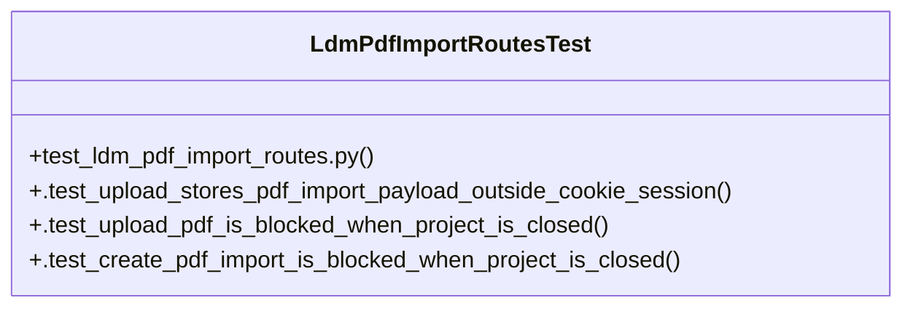

# Community 11

> 44 nodes · cohesion 0.10

## Key Concepts

- [materials.py](file:///Users/macbook/ProjectTracker/tracker/routes/materials.py#L1) (45 connections)
- [import_ldm_csv_upload()](file:///Users/macbook/ProjectTracker/tracker/routes/materials.py#L273) (15 connections)
- [hydrate_ldm()](file:///Users/macbook/ProjectTracker/tracker/catalog.py#L482) (12 connections)
- [_find_project()](file:///Users/macbook/ProjectTracker/tracker/routes/materials.py#L37) (12 connections)
- [import_ldm_pdf_create()](file:///Users/macbook/ProjectTracker/tracker/routes/materials.py#L786) (11 connections)
- [sync_ldm_bundles()](file:///Users/macbook/ProjectTracker/tracker/routes/materials.py#L452) (11 connections)
- [new_ldm()](file:///Users/macbook/ProjectTracker/tracker/routes/materials.py#L225) (10 connections)
- [edit_ldm()](file:///Users/macbook/ProjectTracker/tracker/routes/materials.py#L386) (9 connections)
- [import_ldm_pdf_map()](file:///Users/macbook/ProjectTracker/tracker/routes/materials.py#L758) (9 connections)
- [_bundle_suggestion_ldm()](file:///Users/macbook/ProjectTracker/tracker/routes/materials.py#L163) (8 connections)
- [_clear_pdf_import()](file:///Users/macbook/ProjectTracker/tracker/routes/materials.py#L663) (7 connections)
- [import_ldm_pdf_upload()](file:///Users/macbook/ProjectTracker/tracker/routes/materials.py#L701) (7 connections)
- [ldm_pdf_editor()](file:///Users/macbook/ProjectTracker/tracker/routes/materials.py#L596) (7 connections)
- [_load_pdf_import()](file:///Users/macbook/ProjectTracker/tracker/routes/materials.py#L680) (7 connections)
- [_bundle_sync_suggestions()](file:///Users/macbook/ProjectTracker/tracker/routes/materials.py#L200) (6 connections)
- [_ldm_csv_response()](file:///Users/macbook/ProjectTracker/tracker/routes/materials.py#L128) (6 connections)
- [ldm_pdf()](file:///Users/macbook/ProjectTracker/tracker/routes/materials.py#L569) (6 connections)
- [_pdf_import_path()](file:///Users/macbook/ProjectTracker/tracker/routes/materials.py#L656) (6 connections)
- [_render_ldm_form()](file:///Users/macbook/ProjectTracker/tracker/routes/materials.py#L152) (6 connections)
- [_clean_form_text()](file:///Users/macbook/ProjectTracker/tracker/routes/materials.py#L33) (5 connections)
- [_store_pdf_import()](file:///Users/macbook/ProjectTracker/tracker/routes/materials.py#L671) (5 connections)
- [_csv_already_imported()](file:///Users/macbook/ProjectTracker/tracker/routes/materials.py#L65) (4 connections)
- [delete_ldm()](file:///Users/macbook/ProjectTracker/tracker/routes/materials.py#L519) (4 connections)
- [_hydrate_import_items()](file:///Users/macbook/ProjectTracker/tracker/routes/materials.py#L76) (4 connections)
- [ldm_csv()](file:///Users/macbook/ProjectTracker/tracker/routes/materials.py#L435) (4 connections)
- *... and 19 more nodes in this community*

## Class Diagram

## Relationships

- No strong cross-community connections detected

## Source Files

- [/Users/macbook/Documents/ProjectTracker/tests/test_ldm_pdf_import_routes.py](file:///Users/macbook/Documents/ProjectTracker/tests/test_ldm_pdf_import_routes.py)
- [/Users/macbook/ProjectTracker/tracker/catalog.py](file:///Users/macbook/ProjectTracker/tracker/catalog.py)
- [/Users/macbook/ProjectTracker/tracker/routes/materials.py](file:///Users/macbook/ProjectTracker/tracker/routes/materials.py)

## Audit Trail

- EXTRACTED: 185 (68%)
- INFERRED: 87 (32%)
- AMBIGUOUS: 0 (0%)

---

*Part of the graphify knowledge wiki. See [[index]] to navigate.*