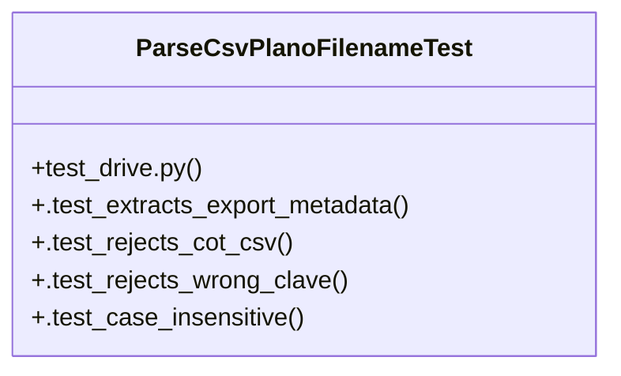

# Community 16

> 29 nodes · cohesion 0.12

## Key Concepts

- [quotes_mobile.py](file:///Users/macbook/ProjectTracker/tracker/routes/quotes_mobile.py#L1) (15 connections)
- [utils.py](file:///Users/macbook/ProjectTracker/tracker/utils.py#L1) (13 connections)
- [mobile_generate_pdf()](file:///Users/macbook/ProjectTracker/tracker/routes/quotes_mobile.py#L170) (12 connections)
- [finite_float()](file:///Users/macbook/ProjectTracker/tracker/utils.py#L7) (12 connections)
- [mobile_add_item()](file:///Users/macbook/ProjectTracker/tracker/routes/quotes_mobile.py#L104) (8 connections)
- **ValueError** (8 connections)
- [_hydrate_quote_for_display()](file:///Users/macbook/ProjectTracker/tracker/routes/quotes_mobile.py#L32) (7 connections)
- [mobile_items()](file:///Users/macbook/ProjectTracker/tracker/routes/quotes_mobile.py#L70) (7 connections)
- [_find_project()](file:///Users/macbook/ProjectTracker/tracker/routes/quotes_mobile.py#L21) (6 connections)
- [parse_csv_plano_filename()](file:///Users/macbook/ProjectTracker/tracker/utils.py#L45) (6 connections)
- [parse_float()](file:///Users/macbook/ProjectTracker/tracker/utils.py#L34) (6 connections)
- [api_ldm_set_costo()](file:///Users/macbook/ProjectTracker/tracker/routes/materials.py#L417) (5 connections)
- [mobile_review()](file:///Users/macbook/ProjectTracker/tracker/routes/quotes_mobile.py#L150) (5 connections)
- [ParseCsvPlanoFilenameTest](file:///Users/macbook/Documents/ProjectTracker/tests/test_drive.py#L6) (5 connections)
- [parse_form_float()](file:///Users/macbook/ProjectTracker/tracker/utils.py#L18) (5 connections)
- [_find_draft()](file:///Users/macbook/ProjectTracker/tracker/routes/quotes_mobile.py#L25) (4 connections)
- [clean()](file:///Users/macbook/ProjectTracker/tracker/utils.py#L14) (4 connections)
- [deleted_catalog_item_at()](file:///Users/macbook/ProjectTracker/tracker/utils.py#L68) (4 connections)
- [_discipline_list()](file:///Users/macbook/ProjectTracker/tracker/routes/quotes_mobile.py#L38) (2 connections)
- [mobile_projects()](file:///Users/macbook/ProjectTracker/tracker/routes/quotes_mobile.py#L52) (2 connections)
- [.test_case_insensitive()](file:///Users/macbook/Documents/ProjectTracker/tests/test_drive.py#L22) (2 connections)
- [.test_extracts_export_metadata()](file:///Users/macbook/Documents/ProjectTracker/tests/test_drive.py#L7) (2 connections)
- [.test_rejects_cot_csv()](file:///Users/macbook/Documents/ProjectTracker/tests/test_drive.py#L16) (2 connections)
- [.test_rejects_wrong_clave()](file:///Users/macbook/Documents/ProjectTracker/tests/test_drive.py#L19) (2 connections)
- [test_drive.py](file:///Users/macbook/Documents/ProjectTracker/tests/test_drive.py#L1) (1 connections)
- *... and 4 more nodes in this community*

## Class Diagram

## Relationships

- No strong cross-community connections detected

## Source Files

- [/Users/macbook/Documents/ProjectTracker/tests/test_drive.py](file:///Users/macbook/Documents/ProjectTracker/tests/test_drive.py)
- [/Users/macbook/ProjectTracker/tracker/routes/materials.py](file:///Users/macbook/ProjectTracker/tracker/routes/materials.py)
- [/Users/macbook/ProjectTracker/tracker/routes/quotes_mobile.py](file:///Users/macbook/ProjectTracker/tracker/routes/quotes_mobile.py)
- [/Users/macbook/ProjectTracker/tracker/utils.py](file:///Users/macbook/ProjectTracker/tracker/utils.py)

## Audit Trail

- EXTRACTED: 94 (63%)
- INFERRED: 55 (37%)
- AMBIGUOUS: 0 (0%)

---

*Part of the graphify knowledge wiki. See [[index]] to navigate.*