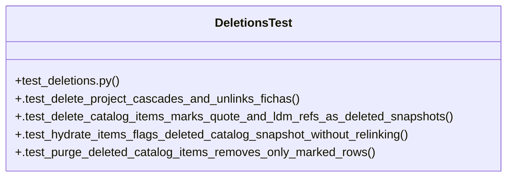

# Community 23

> 17 nodes · cohesion 0.13

## Key Concepts

- [deletions.py](file:///Users/macbook/Documents/ProjectTracker/tracker/deletions.py#L1) (7 connections)
- [delete_catalog_items_data()](file:///Users/macbook/Documents/ProjectTracker/tracker/deletions.py#L38) (6 connections)
- [DeletionsTest](file:///Users/macbook/Documents/ProjectTracker/tests/test_deletions.py#L7) (5 connections)
- [audit_deleted_catalog()](file:///Users/macbook/ProjectTracker/tracker/routes/quotes.py#L1071) (4 connections)
- [audit_deleted_catalog_items()](file:///Users/macbook/Documents/ProjectTracker/tracker/deletions.py#L111) (3 connections)
- [delete_project_data()](file:///Users/macbook/Documents/ProjectTracker/tracker/deletions.py#L4) (3 connections)
- [preserve_deleted_catalog_item_in_record()](file:///Users/macbook/Documents/ProjectTracker/tracker/deletions.py#L94) (3 connections)
- [restore_deleted_catalog_item_in_record()](file:///Users/macbook/Documents/ProjectTracker/tracker/deletions.py#L76) (3 connections)
- [_mark_deleted_catalog_refs()](file:///Users/macbook/Documents/ProjectTracker/tracker/deletions.py#L165) (2 connections)
- [.test_delete_catalog_items_marks_quote_and_ldm_refs_as_deleted_snapshots()](file:///Users/macbook/Documents/ProjectTracker/tests/test_deletions.py#L26) (2 connections)
- [.test_delete_project_cascades_and_unlinks_fichas()](file:///Users/macbook/Documents/ProjectTracker/tests/test_deletions.py#L8) (2 connections)
- [.test_purge_deleted_catalog_items_removes_only_marked_rows()](file:///Users/macbook/Documents/ProjectTracker/tests/test_deletions.py#L99) (2 connections)
- [Audit records for deleted catalog items and return summary statistics.      Args](file:///Users/macbook/ProjectTracker/tracker/deletions.py#L112) (1 connections)
- [Reconnect a deleted catalog item to a new catalog item](file:///Users/macbook/ProjectTracker/tracker/deletions.py#L77) (1 connections)
- [Mark a deleted catalog item as preserved (keep historical reference)](file:///Users/macbook/ProjectTracker/tracker/deletions.py#L95) (1 connections)
- [Audit all quotes and LDMs for deleted catalog items](file:///Users/macbook/ProjectTracker/tracker/routes/quotes.py#L1072) (1 connections)
- [test_deletions.py](file:///Users/macbook/Documents/ProjectTracker/tests/test_deletions.py#L1) (1 connections)

## Class Diagram

## Relationships

- [[Community 0]] (3 shared connections)

## Source Files

- [/Users/macbook/Documents/ProjectTracker/tests/test_deletions.py](file:///Users/macbook/Documents/ProjectTracker/tests/test_deletions.py)
- [/Users/macbook/Documents/ProjectTracker/tracker/deletions.py](file:///Users/macbook/Documents/ProjectTracker/tracker/deletions.py)
- [/Users/macbook/ProjectTracker/tracker/deletions.py](file:///Users/macbook/ProjectTracker/tracker/deletions.py)
- [/Users/macbook/ProjectTracker/tracker/routes/quotes.py](file:///Users/macbook/ProjectTracker/tracker/routes/quotes.py)

## Audit Trail

- EXTRACTED: 33 (70%)
- INFERRED: 14 (30%)
- AMBIGUOUS: 0 (0%)

---

*Part of the graphify knowledge wiki. See [[index]] to navigate.*