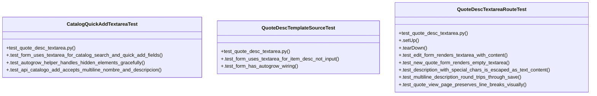

# Community 24

> 15 nodes · cohesion 0.13

## Key Concepts

- [QuoteDescTextareaRouteTest](file:///Users/macbook/Documents/ProjectTracker/tests/test_quote_desc_textarea.py#L64) (8 connections)
- [CatalogQuickAddTextareaTest](file:///Users/macbook/Documents/ProjectTracker/tests/test_quote_desc_textarea.py#L134) (5 connections)
- [test_quote_desc_textarea.py](file:///Users/macbook/Documents/ProjectTracker/tests/test_quote_desc_textarea.py#L1) (4 connections)
- [QuoteDescTemplateSourceTest](file:///Users/macbook/Documents/ProjectTracker/tests/test_quote_desc_textarea.py#L52) (3 connections)
- [.tearDown()](file:///Users/macbook/Documents/ProjectTracker/tests/test_quote_desc_textarea.py#L76) (2 connections)
- [.test_multiline_description_round_trips_through_save()](file:///Users/macbook/Documents/ProjectTracker/tests/test_quote_desc_textarea.py#L104) (2 connections)
- [.test_autogrow_helper_handles_hidden_elements_gracefully()](file:///Users/macbook/Documents/ProjectTracker/tests/test_quote_desc_textarea.py#L149) (1 connections)
- [.test_form_uses_textarea_for_catalog_search_and_quick_add_fields()](file:///Users/macbook/Documents/ProjectTracker/tests/test_quote_desc_textarea.py#L139) (1 connections)
- [.test_form_has_autogrow_wiring()](file:///Users/macbook/Documents/ProjectTracker/tests/test_quote_desc_textarea.py#L59) (1 connections)
- [.test_form_uses_textarea_for_item_desc_not_input()](file:///Users/macbook/Documents/ProjectTracker/tests/test_quote_desc_textarea.py#L53) (1 connections)
- [.test_edit_form_renders_textarea_with_content()](file:///Users/macbook/Documents/ProjectTracker/tests/test_quote_desc_textarea.py#L80) (1 connections)
- [.test_new_quote_form_renders_empty_textarea()](file:///Users/macbook/Documents/ProjectTracker/tests/test_quote_desc_textarea.py#L87) (1 connections)
- [.test_quote_view_page_preserves_line_breaks_visually()](file:///Users/macbook/Documents/ProjectTracker/tests/test_quote_desc_textarea.py#L128) (1 connections)
- [item_desc[] (columna "Nombre / Descripción" de cada partida) es un <textarea> au](file:///Users/macbook/ProjectTracker/tests/test_quote_desc_textarea.py#L1) (1 connections)
- [Buscador de catálogo (catalogSearch) y mini-formulario "Agregar nuevo     artícu](file:///Users/macbook/ProjectTracker/tests/test_quote_desc_textarea.py#L135) (1 connections)

## Class Diagram

## Relationships

- [[Community 33]] (2 shared connections)

## Source Files

- [/Users/macbook/Documents/ProjectTracker/tests/test_quote_desc_textarea.py](file:///Users/macbook/Documents/ProjectTracker/tests/test_quote_desc_textarea.py)
- [/Users/macbook/ProjectTracker/tests/test_quote_desc_textarea.py](file:///Users/macbook/ProjectTracker/tests/test_quote_desc_textarea.py)

## Audit Trail

- EXTRACTED: 31 (94%)
- INFERRED: 2 (6%)
- AMBIGUOUS: 0 (0%)

---

*Part of the graphify knowledge wiki. See [[index]] to navigate.*