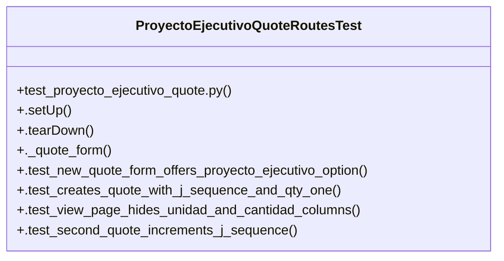

# Community 33

> 9 nodes · cohesion 0.31

## Key Concepts

- [ProyectoEjecutivoQuoteRoutesTest](file:///Users/macbook/Documents/ProjectTracker/tests/test_proyecto_ejecutivo_quote.py#L26) (8 connections)
- [._quote_form()](file:///Users/macbook/Documents/ProjectTracker/tests/test_proyecto_ejecutivo_quote.py#L41) (4 connections)
- [.test_creates_quote_with_j_sequence_and_qty_one()](file:///Users/macbook/Documents/ProjectTracker/tests/test_proyecto_ejecutivo_quote.py#L64) (3 connections)
- [.test_second_quote_increments_j_sequence()](file:///Users/macbook/Documents/ProjectTracker/tests/test_proyecto_ejecutivo_quote.py#L99) (3 connections)
- [.test_view_page_hides_unidad_and_cantidad_columns()](file:///Users/macbook/Documents/ProjectTracker/tests/test_proyecto_ejecutivo_quote.py#L80) (3 connections)
- [.tearDown()](file:///Users/macbook/Documents/ProjectTracker/tests/test_proyecto_ejecutivo_quote.py#L37) (2 connections)
- [test_proyecto_ejecutivo_quote.py](file:///Users/macbook/Documents/ProjectTracker/tests/test_proyecto_ejecutivo_quote.py#L1) (2 connections)
- [.test_new_quote_form_offers_proyecto_ejecutivo_option()](file:///Users/macbook/Documents/ProjectTracker/tests/test_proyecto_ejecutivo_quote.py#L58) (1 connections)
- [Tipo de cotización 'Proyecto Ejecutivo': sin cantidad ni unidad en los artículos](file:///Users/macbook/Documents/ProjectTracker/tests/test_proyecto_ejecutivo_quote.py#L1) (1 connections)

## Class Diagram

## Relationships

- [[Community 0]] (1 shared connections)

## Source Files

- [/Users/macbook/Documents/ProjectTracker/tests/test_proyecto_ejecutivo_quote.py](file:///Users/macbook/Documents/ProjectTracker/tests/test_proyecto_ejecutivo_quote.py)

## Audit Trail

- EXTRACTED: 23 (85%)
- INFERRED: 4 (15%)
- AMBIGUOUS: 0 (0%)

---

*Part of the graphify knowledge wiki. See [[index]] to navigate.*