# Community 7

> 68 nodes · cohesion 0.04

## Key Concepts

- [create_app()](file:///Users/macbook/Documents/ProjectTracker/tracker/__init__.py#L53) (23 connections)
- [AvanceRoutesTest](file:///Users/macbook/Documents/ProjectTracker/tests/test_avance_routes.py#L25) (19 connections)
- [__init__.py](file:///Users/macbook/Documents/ProjectTracker/tracker/__init__.py#L1) (17 connections)
- [._get_project()](file:///Users/macbook/Documents/ProjectTracker/tests/test_avance_routes.py#L41) (13 connections)
- [DiscountFinancialCardRouteTest](file:///Users/macbook/Documents/ProjectTracker/tests/test_project_financial_card_payments.py#L134) (7 connections)
- [_migrate_quote_approval()](file:///Users/macbook/Documents/ProjectTracker/tracker/__init__.py#L109) (6 connections)
- [_requires_configured_secret_key()](file:///Users/macbook/Documents/ProjectTracker/tracker/__init__.py#L49) (6 connections)
- [AppConfigTests](file:///Users/macbook/Documents/ProjectTracker/tests/test_app_config.py#L8) (5 connections)
- [FinancialCardRouteTest](file:///Users/macbook/Documents/ProjectTracker/tests/test_project_financial_card_payments.py#L58) (5 connections)
- [QuoteClientSyncRoutesTest](file:///Users/macbook/Documents/ProjectTracker/tests/test_quote_client_sync.py#L82) (5 connections)
- [CatalogQuickAddTextareaTest](file:///Users/macbook/Documents/ProjectTracker/tests/test_quote_desc_textarea.py#L134) (5 connections)
- [.setUp()](file:///Users/macbook/Documents/ProjectTracker/tests/test_avance_routes.py#L27) (4 connections)
- [.test_update_stage_budget_skips_without_template()](file:///Users/macbook/Documents/ProjectTracker/tests/test_avance_routes.py#L180) (4 connections)
- [.setUp()](file:///Users/macbook/Documents/ProjectTracker/tests/test_payments.py#L112) (4 connections)
- [.setUp()](file:///Users/macbook/Documents/ProjectTracker/tests/test_project_financial_card_payments.py#L139) (4 connections)
- [.setUp()](file:///Users/macbook/Documents/ProjectTracker/tests/test_project_financial_card_payments.py#L59) (4 connections)
- [.setUp()](file:///Users/macbook/Documents/ProjectTracker/tests/test_quote_client_sync.py#L83) (4 connections)
- [.test_api_catalogo_add_accepts_multiline_nombre_and_descripcion()](file:///Users/macbook/Documents/ProjectTracker/tests/test_quote_desc_textarea.py#L155) (4 connections)
- [test_project_financial_card_payments.py](file:///Users/macbook/Documents/ProjectTracker/tests/test_project_financial_card_payments.py#L1) (4 connections)
- [test_quote_desc_textarea.py](file:///Users/macbook/Documents/ProjectTracker/tests/test_quote_desc_textarea.py#L1) (4 connections)
- [_is_production_environment()](file:///Users/macbook/Documents/ProjectTracker/tracker/__init__.py#L39) (3 connections)
- [.test_context_totals_match_discounted_quote()](file:///Users/macbook/Documents/ProjectTracker/tests/test_project_financial_card_payments.py#L174) (3 connections)
- [QuoteDescTemplateSourceTest](file:///Users/macbook/Documents/ProjectTracker/tests/test_quote_desc_textarea.py#L52) (3 connections)
- [test_quote_client_sync.py](file:///Users/macbook/Documents/ProjectTracker/tests/test_quote_client_sync.py#L1) (3 connections)
- [_is_truthy()](file:///Users/macbook/Documents/ProjectTracker/tracker/__init__.py#L35) (2 connections)
- *... and 43 more nodes in this community*

## Class Diagram

```mermaid
classDiagram
    class AppConfigTests {
        +test_app_config.py()
        +.test_default_secret_is_allowed_for_local_startup()
        +.test_default_secret_is_rejected_in_production()
        +.test_custom_secret_is_allowed_in_production()
    }
    class AvanceRoutesTest {
        +test_avance_routes.py()
        +.setUp()
        +.tearDown()
        +._get_project()
        +.test_update_stage_status_sets_stage()
        +.test_update_stage_status_empty_date_stored_as_none()
        +.test_update_stage_status_ignores_empty_stage()
        +.test_update_stage_status_unknown_project_redirects()
        +.test_add_doc_checklist_appends_item()
        +.test_add_doc_checklist_ignores_empty_name()
    }
    class DiscountFinancialCardRouteTest {
        +test_project_financial_card_payments.py()
        +.setUp()
        +.tearDown()
        +.test_cotizado_cliente_reflects_discounted_total()
        +.test_pagado_y_saldo_se_calculan_contra_el_total_con_descuento()
        +.test_context_totals_match_discounted_quote()
    }
    class FinancialCardRouteTest {
        +test_project_financial_card_payments.py()
        +.setUp()
        +.tearDown()
        +.test_project_detail_page_shows_paid_amount_and_balance()
        +.test_project_detail_page_shows_zero_paid_without_payments()
    }
    class FinancialCardTemplateSourceTest {
        +test_project_financial_card_payments.py()
        +.test_project_detail_shows_pagado_and_saldo_rows()
    }
    class QuoteClientSyncRoutesTest {
        +test_quote_client_sync.py()
        +.setUp()
        +.tearDown()
        +.test_quote_detail_page_shows_current_client()
        +.test_quote_resumen_page_shows_current_client()
    }
    class CatalogQuickAddTextareaTest {
        +test_quote_desc_textarea.py()
        +.test_form_uses_textarea_for_catalog_search_and_quick_add_fields()
        +.test_autogrow_helper_handles_hidden_elements_gracefully()
        +.test_api_catalogo_add_accepts_multiline_nombre_and_descripcion()
    }
    class QuoteDescTemplateSourceTest {
        +test_quote_desc_textarea.py()
        +.test_form_uses_textarea_for_item_desc_not_input()
        +.test_form_has_autogrow_wiring()
    }
```

## Relationships

- [[Community 31]] (2 shared connections)
- [[Community 0]] (1 shared connections)
- [[Community 36]] (1 shared connections)

## Source Files

- [/Users/macbook/Documents/ProjectTracker/tests/test_app_config.py](file:///Users/macbook/Documents/ProjectTracker/tests/test_app_config.py)
- [/Users/macbook/Documents/ProjectTracker/tests/test_avance_routes.py](file:///Users/macbook/Documents/ProjectTracker/tests/test_avance_routes.py)
- [/Users/macbook/Documents/ProjectTracker/tests/test_payments.py](file:///Users/macbook/Documents/ProjectTracker/tests/test_payments.py)
- [/Users/macbook/Documents/ProjectTracker/tests/test_project_financial_card_payments.py](file:///Users/macbook/Documents/ProjectTracker/tests/test_project_financial_card_payments.py)
- [/Users/macbook/Documents/ProjectTracker/tests/test_quote_client_sync.py](file:///Users/macbook/Documents/ProjectTracker/tests/test_quote_client_sync.py)
- [/Users/macbook/Documents/ProjectTracker/tests/test_quote_desc_textarea.py](file:///Users/macbook/Documents/ProjectTracker/tests/test_quote_desc_textarea.py)
- [/Users/macbook/Documents/ProjectTracker/tracker/__init__.py](file:///Users/macbook/Documents/ProjectTracker/tracker/__init__.py)
- [/Users/macbook/ProjectTracker/tests/test_project_financial_card_payments.py](file:///Users/macbook/ProjectTracker/tests/test_project_financial_card_payments.py)
- [/Users/macbook/ProjectTracker/tests/test_quote_client_sync.py](file:///Users/macbook/ProjectTracker/tests/test_quote_client_sync.py)
- [/Users/macbook/ProjectTracker/tests/test_quote_desc_textarea.py](file:///Users/macbook/ProjectTracker/tests/test_quote_desc_textarea.py)
- [/Users/macbook/ProjectTracker/tracker/__init__.py](file:///Users/macbook/ProjectTracker/tracker/__init__.py)

## Audit Trail

- EXTRACTED: 169 (75%)
- INFERRED: 56 (25%)
- AMBIGUOUS: 0 (0%)

---

*Part of the graphify knowledge wiki. See [[index]] to navigate.*